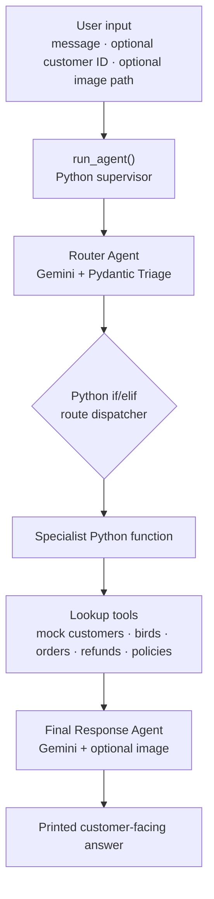

# 🦜 BudgiBird AI Agent

[](https://www.python.org/downloads/)
[](https://jupyter.org/)
[](https://ai.google.dev/)
[](https://docs.pydantic.dev/)
[](https://smith.langchain.com/)

A Python-based **Budgerigar (Budgie) AI customer-support prototype** built with **Google Gemini, Pydantic, and LangSmith**. The project explores structured intent classification, Python-based specialist dispatch, mock shop-data lookups, image-assisted responses, and LLM-generated customer replies.

BudgiBird AI is designed around common budgerigar-care and bird-shop support scenarios. It can route questions about bird care, customer accounts, orders, bird inventory, refunds, company policies, emergencies, and uploaded bird photos.

> **Session 4 · Version 4.0** — Customer, bird, order, refund, and policy records are fictional demonstration data.

> **Architecture clarification:** The current implementation is an LLM-powered router → rule-based Python dispatcher and lookup functions → LLM response generator. The specialist roles are represented by Python functions. Their individual system prompts are defined in `prompt.yml`, but those prompts are not yet sent to Gemini as independent specialist calls.

---

## ✨ Features

### 🧭 Structured Intent Routing

The Router Agent uses Google Gemini and a Pydantic `Triage` schema to classify each text message into one of eight routes:

- `knowledge`
- `customer_support`
- `bird_sales`
- `refund`
- `company_policy`
- `emergency`
- `image_analysis`
- `general`

The structured triage result includes the selected route, category, urgency, a human-escalation flag, and a short summary.

### 🐦 Budgerigar Knowledge Lookup

The Knowledge function retrieves predefined information for a small set of topics:

- Diet
- Behaviour
- Housing
- Breeding
- Mutations

The current knowledge source is a small Python dictionary, not a document-retrieval system or a comprehensive veterinary knowledge base.

### 👤 Customer and Order Support

The Customer Support function:

- Requests a customer ID when the user is a guest.
- Looks up a customer profile using the supplied ID.
- Returns the customer's orders from the in-memory demonstration data.
- Returns a clear not-found result for an unknown customer ID.

### 🛒 Bird Inventory and Sales Information

The Bird Sales function lists birds whose inventory status is `Available`, including the fields stored in the sample bird records. A separate lookup function can retrieve a bird's mutation and price by bird ID.

### 💸 Refund and Company Policy Lookups

The Refund function checks the customer ID, retrieves matching refund records, and returns the refund policy.

The Company Policy function returns the configured policy dictionary, which contains refund, replacement, shipping, and warranty information.

**Scope note:** These functions retrieve information only. They do not approve or issue refunds, process replacements, investigate payments, or contact customers.

### 🚨 Emergency Guidance

The Emergency function returns a general emergency action recommending immediate assessment by an avian veterinarian. It also calls a basic symptom lookup.

The symptom lookup currently uses exact text matching against a small predefined dictionary. It is not a diagnostic model and does not reliably extract symptoms from natural-language messages.

### 🖼️ Image-Assisted Response

The public entry point accepts an optional image path:

```python
run_agent(
    message="Please analyze this budgie.",
    image_path="Injured birds.jpg"
)
```

The image helper reads the file, Base64-encodes it, and attaches it to the final Gemini request. This allows the final response model to consider the image together with the user's question and the selected function's output.

**Important implementation detail:** `image_analysis_agent()` currently returns a placeholder message. The image is not analyzed by an independent Image Analysis Agent; it is passed to the final Gemini response call when `image_path` is provided.

### ✍️ Final Response Generation

The Final Response Agent makes a second Gemini call. It receives:

- The user's original message.
- The selected Python function's output.
- The optional image, if one was supplied.

The final-response prompt instructs Gemini to be concise, use the supplied tool output, avoid inventing customer or inventory details, and recommend veterinary care when appropriate.

### 🛡️ Prompt-Level Guardrails

The final-response instructions in `prompt.yml` tell the model to:

- Be friendly and concise.
- Avoid inventing customer, bird, or refund information.
- Avoid claiming a definitive veterinary diagnosis.
- Recommend an avian veterinarian when appropriate.
- Strongly recommend immediate veterinary care for emergencies.
- Describe only visible details when responding to an image-analysis request.

These are prompt-level instructions, not a substitute for deterministic safety checks or professional veterinary review.

### 📊 Observability and Token Tracking

- Key functions and lookup tools use LangSmith's `@traceable` decorator.
- The Gemini client is wrapped for LangSmith tracing.
- Router and final-response token usage is accumulated.
- The notebook prints an estimated API cost using the configured `INPUT_PRICE` and `OUTPUT_PRICE` values.

The displayed cost is an estimate and must be updated to reflect the pricing applicable to the selected model and account.

---

## 🔄 How It Works

### Actual execution flow



### Request lifecycle

1. `run_agent(message, customer_id=None, image_path=None)` receives the user request.
2. `router_agent(message)` sends the text message to Gemini with the router system prompt and Pydantic response schema.
3. Gemini returns a structured `Triage` object.
4. `run_agent()` uses Python `if/elif` conditions to select one specialist function.
5. The selected function calls the relevant lookup tool or returns a predefined result.
6. The original user message and selected function output are passed to the Final Response Agent. If an image path was supplied, the image is attached to this Gemini request.
7. The notebook prints the selected function, tool result, final answer, conversation length, and token usage.

**The normal request path makes two Gemini calls:** one for routing and one for final response generation. The specialist functions do not make their own Gemini calls.

### What "agent" means in this version

The project uses agent-oriented names and prompt definitions, but the current execution model is not yet a set of independently reasoning LLM agents.

| Component | Current implementation |
|---|---|
| Router Agent | Gemini LLM call with structured Pydantic output |
| Knowledge Agent | Python function calling a predefined knowledge lookup |
| Customer Support Agent | Python function calling customer and order lookups |
| Bird Sales Agent | Python function calling inventory lookup |
| Refund Agent | Python function calling customer, refund, and policy lookups |
| Company Policy Agent | Python function returning policy data |
| Emergency Agent | Python function calling emergency and exact-match symptom lookups |
| Image Analysis Agent | Python placeholder function |
| Final Response Agent | Gemini LLM call that writes the final answer |

The seven specialist prompts are loaded from `prompt.yml`, but only `router_system` and `reply_system` are currently used in Gemini generation calls.

---

## 🛠️ Technology Stack

| Technology | Role in this project |
|---|---|
| Python 3.11 | Main programming language |
| Jupyter Notebook | Development and execution interface |
| Google Gemini (`gemini-3.1-flash-lite`) | Intent classification and final response generation |
| `google-genai` | Gemini Python SDK |
| Pydantic | Structured router output and validation |
| PyYAML | Loading prompt definitions from `prompt.yml` |
| `python-dotenv` | Loading environment variables |
| LangSmith | Tracing and observability |
| Base64 and `mimetypes` | Encoding and identifying image files |
| Python dictionaries | In-memory mock data store |

---

## 📁 Project Structure

```text
Filedwork_season4/
├── session4.ipynb       # Main notebook: data, tools, functions, routing and demo runs
├── prompt.yml           # Router, specialist-role and final-response prompts
├── utils.py             # Reserved for helper functions (currently empty)
├── Injured birds.jpg    # Sample image for the image-assisted demo
├── requirements.txt     # Exported Python package list
├── .gitignore           # Excludes venv, .env, caches and notebook checkpoints
└── README.md            # Project documentation
```

### Inside `session4.ipynb`

1. **Setup** — imports, environment loading, Gemini and LangSmith clients, prompt loading, token tracking, and image encoding.
2. **Router Schema** — the Pydantic `Triage` model.
3. **Mock Data** — customer, bird, order, refund, and policy dictionaries.
4. **Tool Layer** — traced lookup functions over the mock data.
5. **Router Agent** — Gemini call that returns structured triage output.
6. **Specialist Functions** — knowledge, customer support, sales, refund, policy, emergency, and image functions.
7. **Final Response Agent** — Gemini call that generates the customer-facing response.
8. **Supervisor** — `run_agent()` performs rule-based dispatch and coordinates the request.
9. **Demo Runs** — notebook examples for the main customer-support scenarios.

---

## 🚀 Getting Started

### Prerequisites

- Python 3.11 or higher.
- A Google Gemini API key from [Google AI Studio](https://aistudio.google.com/).
- (Optional) A LangSmith API key for tracing and debugging.
- Jupyter Notebook or JupyterLab.

### 1. Clone the repository

```bash
git clone https://github.com/<your-username>/Filedwork_season4.git
cd Filedwork_season4
```

### 2. Create and activate a virtual environment

**Windows PowerShell**

```powershell
python -m venv venv
venv\Scripts\Activate.ps1
```

**macOS / Linux**

```bash
python3 -m venv venv
source venv/bin/activate
```

### 3. Install dependencies

The current `requirements.txt` is an exported Windows environment package list. It includes `pywinpty`, which is Windows-specific, and does not include `langsmith`, although the notebook imports it.

For a clean cross-platform environment, install the notebook's direct dependencies:

```bash
python -m pip install --upgrade pip
python -m pip install google-genai python-dotenv pydantic PyYAML langsmith jupyter ipykernel
```

Alternatively, on Windows, you can use the supplied requirements file and install the missing package separately:

```bash
pip install -r requirements.txt
pip install langsmith
```

### 4. Configure environment variables

Create a `.env` file in the project root:

```env
GEMINI_API_KEY=your_gemini_api_key_here

# Optional: LangSmith tracing
LANGSMITH_TRACING=true
LANGSMITH_API_KEY=your_langsmith_api_key_here
LANGSMITH_PROJECT=BudgiBird AI
```

Keep `.env` private. Do not commit API keys to GitHub.

### 5. Launch Jupyter

Run Jupyter from the project root because the notebook loads `prompt.yml` and the sample image using relative paths.

```bash
jupyter lab
```

Open `session4.ipynb`, select the virtual environment's kernel, and execute the cells from top to bottom.

---

## 🧪 Try It Out

`run_agent()` is the notebook's main entry point:

```python
run_agent(message, customer_id=None, image_path=None)
```

### Bird-care question

```python
run_agent(
    message="Can my budgie eat cucumber?"
)
```

### Customer order lookup

```python
run_agent(
    customer_id="C001",
    message="Where is my order?"
)
```

### Refund inquiry

```python
run_agent(
    customer_id="C001",
    message="Can you check my refund status?"
)
```

### Bird inventory

```python
run_agent(
    message="Which birds are currently available?"
)
```

### Image-assisted question

```python
run_agent(
    message="Please analyze this budgie.",
    image_path="Injured birds.jpg"
)
```

---

## 🗃️ Demonstration Data

The notebook uses five in-memory data collections:

| Collection | Contents |
|---|---|
| `CUSTOMERS` | Sample customer profiles |
| `BIRDS` | Sample bird inventory, including mutation, gender, age, price, and status |
| `ORDERS` | Sample orders associated with customer IDs |
| `REFUNDS` | Sample refund records and statuses |
| `POLICIES` | Refund, replacement, shipping, and warranty policy text |

The notebook's sample records include customer IDs such as `C001` and `C002`, and available bird IDs such as `B004` and `B005`. These are fictional demonstration records, not live shop data.

Guest customer-support and refund lookups request a customer ID. An unknown customer ID returns a not-found result.

---

## 🧾 Example Output

A typical notebook run prints the customer context, question, router result, selected function, lookup output, final answer, conversation length, and token usage.

```text
CUSTOMER : C001
QUESTION : Where is my order?

ROUTER
{
  'route': 'customer_support',
  'category': 'order',
  'urgency': 'medium',
  'needs_human': False,
  'summary': 'The user is inquiring about the status of their order.'
}

SELECTED AGENT
Customer Support Agent

TOOL RESULT
{ ... }

BUDGIBIRD AI
[Gemini-generated response based on the supplied tool output]
```

The exact wording and token counts can vary between model calls.

---

## ⚠️ Current Limitations

This is a learning and development prototype. The following limitations are present in the current code:

1. **Specialist prompts are not executed independently.** The specialist functions are Python lookup/dispatch functions. Only the router and final-response prompts are sent to Gemini.
2. **Conversation history is not model memory.** `history` stores user and assistant messages, but it is not passed into later Gemini calls. Follow-up requests therefore do not receive prior conversational context.
3. **Router metadata is not used for control.** The router produces `urgency`, `needs_human`, and `summary`, but the supervisor currently does not use these fields to trigger escalation or alter the workflow.
4. **Router receives only the text message.** The customer ID and image path are not provided to the router call. Image input is attached later to the final response request.
5. **Image specialist is a placeholder.** `image_analysis_agent()` calls a placeholder tool; the final Gemini call is where the supplied image is actually included.
6. **Knowledge retrieval is limited.** The knowledge tool uses a small predefined dictionary and returns a generic fallback for unsupported categories.
7. **Symptom matching is basic.** `disease_tool()` uses exact string matching. Passing a complete natural-language message often produces `No disease information available.`
8. **Business data is hardcoded.** The project has no persistent database or live shop integration.
9. **No real transaction workflows.** Refund approval, replacement processing, payment investigation, and customer notifications are not implemented.
10. **No formal automated test suite.** Notebook examples are manual demonstrations; there are no assertions or defined pass/fail criteria.
11. **Limited error handling.** The current `run_agent()` path does not implement a robust exception-handling and recovery strategy, and it prints the answer rather than returning it.
12. **Dependency cleanup is needed.** The supplied requirements file is Windows-oriented and omits the imported `langsmith` dependency.

---

## 🔮 Roadmap

Potential next steps for evolving the project:

- **Independent specialist execution:** Integrate the seven specialist prompts with dedicated Gemini calls where contextual reasoning is useful.
- **Tool-first design:** Keep deterministic lookups and database operations as Python tools; use LLM reasoning only where it adds value.
- **Supervisor improvements:** Use urgency and human-escalation signals to control routing and escalation.
- **Conversation memory:** Add session-specific history and pass relevant context into model calls.
- **Knowledge RAG:** Build a curated budgerigar-care knowledge base with retrieval and source references.
- **Image analysis:** Give the image workflow a dedicated vision-processing interface and structured output.
- **Emergency safeguards:** Improve symptom extraction, escalation rules, and veterinary-care guidance.
- **Persistent data:** Replace demonstration dictionaries with a database and controlled data-access layer.
- **Testing:** Add unit tests for tools, routing tests, and end-to-end evaluation cases with explicit expected outcomes.
- **Reliability:** Add input validation, API/file error handling, logging, and dependency management.
- **User interface:** Build a web interface after the core backend behavior is tested.

---

## ⚕️ Disclaimer

BudgiBird AI is an educational software demonstration. All customer, bird, order, refund, and policy data are fictional. It is not a replacement for professional veterinary advice, diagnosis, or treatment.

If a budgerigar has heavy bleeding, difficulty breathing, seizures, cannot stand, or shows another severe symptom, contact an avian veterinarian or emergency veterinary service immediately. Do not delay professional care while using this application.

---

## 👨‍💻 Author

**MD Minhaz Uddin**  
B.Sc. in Computer Science & Engineering  
International Islamic University Chittagong (IIUC)

**Project:** BudgiBird AI Agent  
**Session:** 4  
**Version:** 4.0

